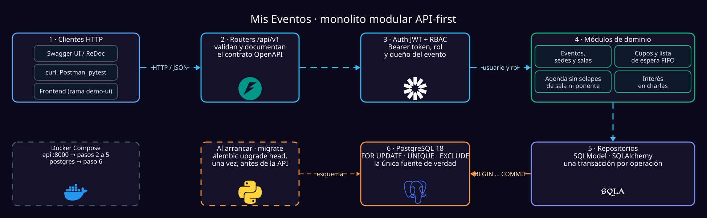
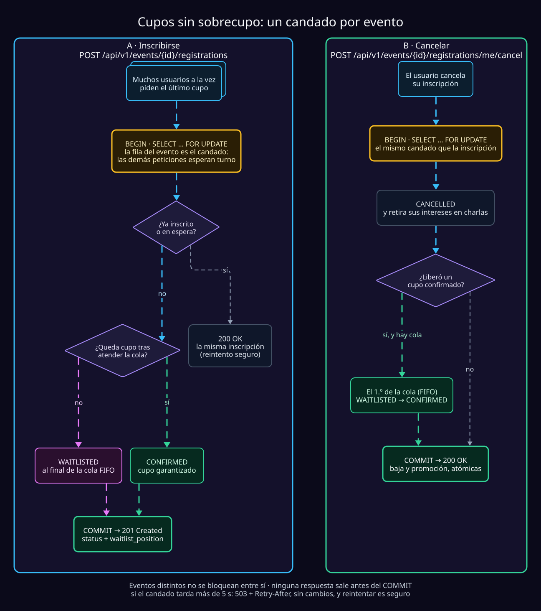

<div align="center">

# Mis Eventos
### Event Management System · RESTful API

**Plataforma API-first de alta consistencia para la gestión de eventos, conferencias, control de aforos y listas de espera concurrentes.**

<br/>

[](#)
[](#)
[](#)
[](#)
[](#)
[](#)
[](#)

[](#estado-del-proyecto)
[](#arquitectura-del-sistema)
[](https://github.com/lStiven/tusdatos/tree/demo-ui)

<br/>

[**Explorar Documentación**](#documentación-técnica-y-estructura) · [**Inicio Rápido**](#inicio-rápido-backend) · [**Probar Demo Gráfica**](#demo-con-interfaz-gráfica) · [**Guía del Backend**](backend/README.md)

</div>

---

> [!IMPORTANT]
> **Prueba Técnica — Python Backend Engineering**
> La rama `master` contiene exclusivamente la arquitectura y el código del backend. Para facilitar la evaluación funcional sin depender únicamente de clientes HTTP, se construyó una interfaz gráfica interactiva disponible en la rama [`demo-ui`](https://github.com/lStiven/tusdatos/tree/demo-ui).

## Visión General

**Mis Eventos** centraliza la operación completa de eventos y conferencias resolviendo los problemas clásicos de concurrencia en boletería y asignación de espacios: sobrecupos (*overbooking*), colisiones de horarios entre ponentes o salas, y gestión justa de listas de espera.

El sistema está diseñado bajo una filosofía estricta **API-first**. Toda la lógica de dominio, invariantes de negocio, control de acceso (RBAC) y garantías transaccionales residen y se validan en el backend, garantizando la integridad de los datos sin importar qué cliente consuma el servicio.

---

## Arquitectura del Sistema

El proyecto implementa un **monolito modular** desacoplado por capas. Esta decisión evita la complejidad operativa de microservicios prematuros mientras mantiene límites de dominio claros, alta cohesión y facilidad de prueba.



### Motor de Concurrencia y Lista de Espera

Uno de los mayores retos técnicos es evitar que múltiples peticiones simultáneas sobre el último cupo disponible generen sobrecupo, además de asegurar que las cancelaciones promuevan automáticamente al siguiente usuario en espera respetando estrictamente el orden de llegada (FIFO).



---

## Capacidades y Reglas de Negocio

El sistema está dividido en dominios cohesivos. Despliega cada sección para inspeccionar las invariantes técnicas que protege el backend:

<details open>
<summary><b>1. Gestión de Cupos, Concurrencia y Lista de Espera (FIFO)</b></summary>
<br/>

- **Límite estricto de capacidad:** Ningún evento puede superar su aforo máximo configurado bajo escenarios de alta concurrencia.
- **Encolamiento automático:** Al agotarse la capacidad, las nuevas solicitudes pasan automáticamente a estado de espera sin rechazar la transacción del usuario.
- **Promoción determinista:** Ante la cancelación de un asistente confirmado, el sistema promueve de forma atómica al primer usuario en espera según su marca de tiempo.
- **Detalle técnico:** Consulta el diseño completo en [Concurrencia, cupos y lista de espera](docs/03-concurrencia-cupos-y-lista-de-espera.md).
</details>

<details>
<summary><b>2. Programación de Charlas y Prevención de Conflictos</b></summary>
<br/>

- **Exclusión mutua de espacios:** El motor valida que una sala no pueda asignarse a dos charlas cuyos rangos de tiempo se superpongan.
- **Validación de aforo físico:** La capacidad de la sala asignada debe ser compatible con los requisitos de la sesión.
- **Disponibilidad de ponentes:** Un ponente no puede ser programado en dos salas distintas en horarios simultáneos.
- **Métricas desacopladas del cupo:** Los asistentes pueden marcar interés en múltiples charlas (incluso en el mismo horario) con fines analíticos para los organizadores, sin que esto bloquee asientos físicos.
</details>

<details>
<summary><b>3. Seguridad, Identidad y Control de Acceso (RBAC)</b></summary>
<br/>

- **Autenticación sin estado:** Basada en tokens firmados (`JWT`) con validación en cada ruta protegida.
- **Aislamiento por propietario:** Los usuarios con rol de *Organizador* solo tienen permisos de escritura/modificación sobre los eventos y charlas que ellos mismos crearon.
- **Supervisión global:** El rol de *Administrador* posee privilegios transversales sobre catálogos de sedes, salas, usuarios y eventos.
</details>

<details>
<summary><b>4. Catálogo Completo de Módulos de la API</b></summary>
<br/>

| Dominio | Alcance Funcional en la API |
|:---|:---|
| **Autenticación y Usuarios** | Registro, emisión de tokens JWT, gestión de perfiles y asignación de roles. |
| **Eventos, Sedes y Salas** | CRUD completo de ubicaciones físicas, capacidades por sala y ciclo de vida del evento. |
| **Ponentes y Charlas** | Catálogo de expositores, asignación de horarios y motor de validación de cruces. |
| **Inscripciones y Waitlist** | Toma de cupos, encolamiento automático, cancelaciones y promociones por orden de llegada. |
| **Telemetría y Salud** | Conteo de interés por charla para analítica de aforo y endpoint de *Health Check*. |

</details>

---

## Inicio Rápido (Backend)

Estas instrucciones levantan el entorno completo del backend en la rama `master` (PostgreSQL + ejecución automática de migraciones con Alembic + servidor FastAPI).

### Prerrequisitos
- **Docker** y **Docker Compose**
- **Python 3** (únicamente para ejecutar el generador inicial de variables de entorno)

### Despliegue en 3 comandos

```bash
# 1. Clonar el repositorio y ubicarse en la rama principal
git clone [https://github.com/lStiven/tusdatos.git](https://github.com/lStiven/tusdatos.git) && cd tusdatos && git switch master

# 2. Generar archivo backend/.env con claves criptográficas seguras (JWT_SECRET_KEY)
python3 scripts/bootstrap_env.py

# 3. Construir y levantar los contenedores en segundo plano
docker compose up --build -d
```

### Exploración y Pruebas de la API

Una vez que los contenedores estén activos, la documentación interactiva estará disponible en tu navegador:

| Herramienta | Enlace Local | Propósito |
|:---|:---|:---|
| **Swagger UI** | [`http://localhost:8000/docs`](http://localhost:8000/docs) | Consola interactiva para probar endpoints y autenticación JWT. |
| **ReDoc** | [`http://localhost:8000/redoc`](http://localhost:8000/redoc) | Documentación de referencia de esquemas y contratos OpenAPI. |

> [!TIP]
> **¿Cómo evaluar todos los casos de uso?**
> En la **[Guía Técnica del Backend →](backend/README.md)** encontrarás los comandos exactos para crear el primer administrador, poblar la base de datos con [datos de demostración](backend/README.md#datos-de-demo-opcional), ejecutar la suite de pruebas con `pytest` y generar reportes de cobertura.

---

## Demo con Interfaz Gráfica

Para facilitar las pruebas funcionales de extremo a extremo sin construir peticiones HTTP manualmente, puedes cambiar a la rama `demo-ui`, la cual integra un cliente web conectado directamente a esta API.

| Rama | Contenido | Propósito en la evaluación |
|:---|:---|:---|
| [`master`](https://github.com/lStiven/tusdatos/tree/master) | **Solo Backend** | Revisión de código, arquitectura, pruebas unitarias/integración y diseño API. |
| [`demo-ui`](https://github.com/lStiven/tusdatos/tree/demo-ui) | **Backend + Frontend** | Exploración visual rápida de flujos de inscripción, listas de espera y paneles. |

```bash
# Cambiar a la rama de demostración gráfica y levantar el entorno completo
git fetch origin
git switch demo-ui
python3 scripts/bootstrap_env.py
docker compose up --build -d
```

Consulta el README específico de la rama **[`demo-ui` →](https://github.com/lStiven/tusdatos/tree/demo-ui)** para ver los puertos de acceso y credenciales de prueba.

---

## Documentación Técnica y Estructura

El diseño arquitectónico y las decisiones de ingeniería están documentados en la carpeta `docs/` para facilitar la revisión técnica:

| Documento | Descripción y Alcance Técnico |
|:---|:---|
| [**00 · Guía del Backend**](backend/README.md) | Comandos de testing (`pytest`), cobertura, semillas de datos y uso de Dev Containers. |
| [**01 · Problema y Alcance del MVP**](docs/01-problema-solucion-y-alcance.md) | Definición de actores, casos de uso críticos y criterios de aceptación. |
| [**02 · Arquitectura y Contenedores**](docs/02-arquitectura-y-contenedores.md) | Diseño del monolito modular, topología de contenedores y ciclo de vida. |
| [**03 · Concurrencia y Lista de Espera**](docs/03-concurrencia-cupos-y-lista-de-espera.md) | Estrategia de bloqueos, manejo de condiciones de carrera y garantías FIFO. |
| [**04 · Modelo de Dominio y Base de Datos**](docs/04-modelo-dominio-y-base-de-datos.md) | Diagrama entidad-relación, restricciones de integridad e índices en PostgreSQL. |

### Árbol del Proyecto (`master`)

```text
.
├── backend/                     # Código fuente de la API, modelos de dominio, migraciones y suite de tests
│   └── README.md                # Manual operativo del backend (tests, seeds, comandos locales)
├── docs/                        # Documentación de arquitectura, decisiones técnicas y modelo de datos
├── docker/
│   └── postgres/                # Scripts de inicialización para bases de datos de desarrollo y testing
├── scripts/
│   └── bootstrap_env.py         # Automatización de variables de entorno y secretos criptográficos
├── .devcontainer/               # Configuración reproducible para desarrollo en VS Code Dev Containers
└── compose.yaml                 # Orquestación de servicios: PostgreSQL + Migraciones (Alembic) + FastAPI
```

---

## Estado del Proyecto

El alcance actual cubre el **100% de los requerimientos funcionales y técnicos del MVP** para ejecución y evaluación en entornos locales containerizados (el despliegue en nube pública queda fuera del alcance de esta entrega):

- [x] Modelado relacional en PostgreSQL y versionado de esquemas con **Alembic**.
- [x] Autenticación **JWT** y autorización granular basada en roles (**RBAC**).
- [x] Módulos de administración de usuarios, sedes, salas, ponentes y eventos.
- [x] Motor transaccional de inscripciones con control de cupos y **lista de espera FIFO**.
- [x] Algoritmo de validación de conflictos de horario para salas y ponentes.
- [x] Registro de métricas de interés por charla y endpoint de *Health Check*.
- [x] Entorno 100% reproducible con **Docker Compose**, `uv` y **Dev Containers**.
- [x] Suite de pruebas automatizadas con **pytest** y contratos **OpenAPI**.

---

<div align="center">
  <sub>Desarrollado para evaluación técnica de Ingeniería de Software Backend · Octubre 2026</sub>
</div>
