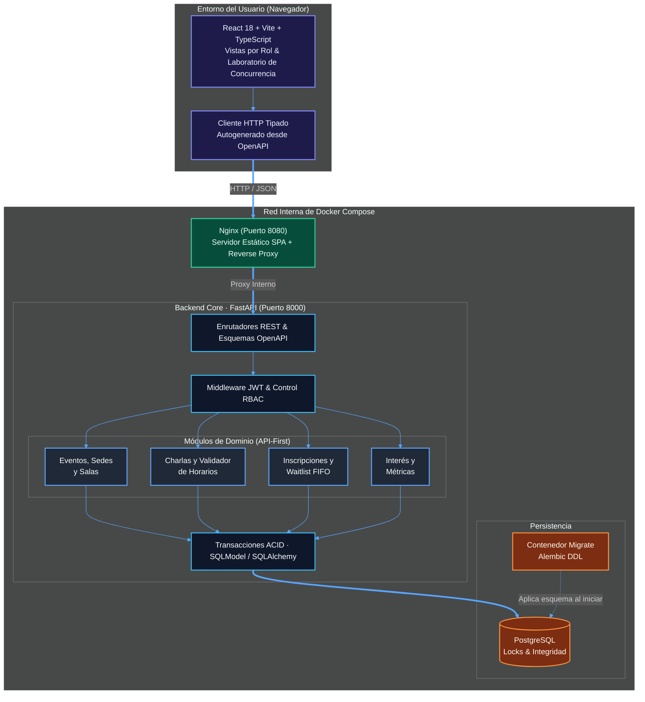

<div align="center">

# Mis Eventos · Full-Stack Demo
### Event Management System · RESTful API + Interactive Web UI

**Plataforma API-first de alta consistencia para la gestión de eventos, conferencias, control de aforos y listas de espera concurrentes, acompañada de una interfaz gráfica y un laboratorio de pruebas en vivo.**

<br/>

[](#)
[](#)
[](#)
[](#)
[](#)
[](#)
[](#)
[](#)

[-8250DF?style=flat-square)](#)
[_→-0969da?style=flat-square)](https://github.com/lStiven/tusdatos/tree/master)
[](#estado-del-proyecto)

<br/>

[**Levantar Demo en 1 Minuto**](#inicio-rápido-stack-completo) · [**Arquitectura Full-Stack**](#arquitectura-del-sistema) · [**Guía Backend**](backend/README.md) · [**Guía Frontend**](frontend/README.md)

</div>

---

> [!IMPORTANT]
> **Entorno de Demostración Interactiva (`demo-ui`)**
> Esta rama extiende la implementación oficial del backend ([rama `master`](https://github.com/lStiven/tusdatos/tree/master)) incorporando una **Single Page Application (SPA)** en React y TypeScript. Su propósito es permitir la evaluación visual de todos los flujos por rol (Asistente, Organizador, Administrador) e incluye un **Laboratorio de Concurrencia** que pone a prueba las invariantes del backend contra la API real.

## ¿Qué problema resuelve?

La organización manual de eventos mediante hojas de cálculo, correos y formularios aislados provoca sobrecupos (*overbooking*), cruces de horarios en salas o ponentes, y falta de trazabilidad en las listas de espera.

**Mis Eventos** centraliza el modelo de datos en **PostgreSQL**, protege las reglas de negocio estrictamente en el backend con **FastAPI** bajo un diseño **API-first**, y expone un cliente web tipado de extremo a extremo (generado automáticamente desde el contrato **OpenAPI**) servido mediante **Nginx**.

---

## Inicio Rápido (Stack Completo)

Un único flujo con Docker Compose construye y orquesta la base de datos, ejecuta las migraciones con Alembic, levanta la API y sirve el frontend en producción local.

### 1. Desplegar los contenedores

```bash
# 1. Generar backend/.env con JWT_SECRET_KEY criptográfica (no sobrescribe si ya existe)
python3 scripts/bootstrap_env.py

# 2. Construir y levantar PostgreSQL + Migraciones + API + Frontend Web
docker compose up --build -d

# 3. Verificar que los servicios 'api' y 'web' reporten estado «healthy»
docker compose ps
```

### 2. Poblar datos de demostración (Recomendado)

Elige cómo deseas autenticarte en la plataforma:

```bash
# OPCIÓN A (Inmediata): Sembrar eventos, charlas, salas y usuarios de prueba
docker compose exec api python -m app.modules.demo.cli seed
```
> Al ejecutar el `seed`, la pantalla de inicio de sesión en **`http://localhost:8080`** habilitará **botones de acceso en 1 clic** para entrar como *Asistente*, *Organizadora* o *Administrador* (contraseña general: `demo1234`).

```bash
# OPCIÓN B (Manual): Crear únicamente tu propio usuario Administrador desde cero
docker compose exec api python -m app.modules.auth.cli create-admin \
  --email admin@example.com \
  --full-name "Admin"
```

### 3. Puntos de Acceso Locales

| Servicio | URL Local | Descripción |
|:---|:---|:---|
| **Aplicación Web (UI)** | [`http://localhost:8080`](http://localhost:8080) | Interfaz gráfica por roles + Laboratorio de reglas y concurrencia. |
| **Swagger UI (OpenAPI)** | [`http://localhost:8000/docs`](http://localhost:8000/docs) | Documentación interactiva de endpoints, autenticación, errores y paginación. |
| **ReDoc** | [`http://localhost:8000/redoc`](http://localhost:8000/redoc) | Referencia técnica de esquemas y contratos de la API REST. |

<details>
<summary><b>🛠️ Solución de problemas y casos de uso frecuentes (Puertos ocupados, reinicio de BD, logs)</b></summary>
<br/>

| Escenario | Comando / Solución |
|:---|:---|
| **Acabo de clonar el repo** | Ejecuta los 3 comandos del paso 1. La primera construcción descarga las imágenes base e instala dependencias de Python (`uv`) y Node. |
| **Actualicé el código (`git pull`)** | Ejecuta `docker compose up --build -d`. Reconstruye solo las capas modificadas conservando los datos de PostgreSQL. |
| **Puertos `8080` u `8000` ocupados** | Ejecuta `WEB_PORT=8081 API_PORT=8001 docker compose up --build -d`. El frontend no se rompe porque **Nginx** enruta hacia la API usando la red interna de Docker. |
| **Quiero reiniciar la base de datos a cero** | Ejecuta `docker compose down -v` (elimina volúmenes) y vuelve a levantar con `docker compose up --build -d`. |
| **Inspeccionar fallos de arranque** | Revisa los registros específicos con `docker compose logs migrate`, `docker compose logs api` o `docker compose logs web`. |

</details>

---

## Arquitectura del Sistema

El sistema opera bajo un **monolito modular** en el backend consumido por una **SPA en React/TypeScript**. El acoplamiento de contratos se mantiene sincronizado generando el cliente HTTP del frontend directamente desde la especificación OpenAPI de FastAPI, mientras que **Nginx** actúa como servidor web y *reverse proxy* dentro de la red de contenedores.



### Flujo Transaccional: Control de Cupos y Lista de Espera

La interfaz gráfica incluye un laboratorio que dispara peticiones concurrentes hacia la API para demostrar cómo el backend previene condiciones de carrera (*race conditions*) y gestiona la cola de espera:

```mermaid
%%{init: {
  'theme': 'dark',
  'themeVariables': {
    'actorBkg': '#1f6feb',
    'actorTextColor': '#ffffff',
    'actorBorder': '#58a6ff',
    'actorLineColor': '#8b949e',
    'signalColor': '#58a6ff',
    'signalTextColor': '#f0f6fc',
    'labelBoxBkgColor': '#21262d',
    'labelBoxBorderColor': '#30363d',
    'labelTextColor': '#f0f6fc',
    'loopTextColor': '#f0f6fc',
    'noteBkgColor': '#3b2300',
    'noteTextColor': '#f0f6fc',
    'noteBorderColor': '#d29922'
  }
}}%%
sequenceDiagram
    autonumber
    actor User as Cliente Web (SPA)
    participant API as FastAPI (Endpoints)
    participant Svc as Servicio de Dominio
    participant DB as PostgreSQL (ACID)

    rect rgb(13, 27, 42)
    note right of User: Escenario A: Inscripción bajo Concurrencia
    User->>API: POST /events/{id}/register
    API->>Svc: Procesar solicitud
    Svc->>DB: BEGIN + Bloqueo de control de capacidad
    DB-->>Svc: Cupos confirmados actuales

    alt Hay cupos disponibles (Confirmados menor a Capacidad)
        Svc->>DB: INSERT Inscripción (CONFIRMADA)
        DB-->>Svc: Commit exitoso
        Svc-->>API: 201 Created (Cupo Reservado)
    else Aforo al 100% (Capacidad Agotada)
        Svc->>DB: INSERT en Lista de Espera (Orden FIFO)
        DB-->>Svc: Commit exitoso
        Svc-->>API: 202 Accepted (En Lista de Espera)
    end
    API-->>User: Actualiza estado en UI
    end

    rect rgb(10, 38, 28)
    note right of User: Escenario B: Cancelación y Promoción Automática
    User->>API: DELETE /events/{id}/register (Cancelar)
    API->>Svc: Ejecutar baja e inspeccionar cola
    Svc->>DB: BEGIN Transaction
    Svc->>DB: Marcar inscripción como CANCELADA
    Svc->>DB: Seleccionar 1er candidato en espera (FIFO)
    opt Existe usuario en Lista de Espera
        Svc->>DB: Promover estado: EN_ESPERA a CONFIRMADA
    end
    Svc->>DB: COMMIT Transaction
    Svc-->>API: 200 OK (Promoción atómica completada)
    API-->>User: Refleja cupo reasignado en UI
    end
```



---

## Principios de Diseño e Invariantes de Negocio

El frontend actúa exclusivamente como capa de presentación y experiencia de usuario; **ninguna regla de negocio se delega al navegador**:

<details open>
<summary><b>1. Separación entre Cupo de Evento e Interés por Charla</b></summary>
<br/>

- **Inscripción al evento:** Reserva un cupo real sobre la capacidad máxima del evento. Al llenarse, las nuevas solicitudes ingresan automáticamente a la lista de espera y se promueven por estricto orden de llegada (FIFO).
- **Interés en charlas:** Permite a los asistentes marcar las sesiones a las que planean asistir (incluso si ocurren en horarios simultáneos). Su finalidad es estadística y analítica para los organizadores, por lo que **no bloquea asientos físicos**.
</details>

<details>
<summary><b>2. Prevención de Solapes en Salas y Ponentes</b></summary>
<br/>

- **Exclusión temporal de salas:** Una sala no puede asignarse a dos sesiones cuyos horarios se superpongan.
- **Capacidad física:** El aforo de la sala debe ser mayor o igual a la capacidad configurada para la sesión.
- **Disponibilidad de ponentes:** El backend impide asignar al mismo ponente en dos charlas simultáneas.
</details>

<details>
<summary><b>3. Permisos por Rol (RBAC) y Paridad de Entornos</b></summary>
<br/>

- **Propiedad estricta:** Un *Organizador* únicamente puede modificar o administrar los eventos que le pertenecen. El rol *Administrador* posee control global sobre cualquier evento, catálogo y charla.
- **Inmutabilidad de despliegue:** El sistema se comporta igual en desarrollo, pruebas y producción mediante inyección de variables de entorno. Los *Dev Containers* se utilizan como entorno reproducible de desarrollo, no como artefacto de despliegue.
</details>

---

## Mapa de Documentación

Cada documento responde a una inquietud específica de ingeniería y vive en una única ubicación:

| ¿Qué necesitas consultar? | Ubicación Directa |
|:---|:---|
| **¿Cómo configuro, ejecuto y corro tests en el backend?** | [**`backend/README.md`**](backend/README.md) |
| **¿Cómo desarrollo, compilo y pruebo el frontend?** | [**`frontend/README.md`**](frontend/README.md) |
| **¿Qué reglas aplica cada endpoint, paginación y códigos de error?** | Contrato OpenAPI en vivo: [**`/docs`**](http://localhost:8000/docs) (Swagger) o [**`/redoc`**](http://localhost:8000/redoc) |
| **01 · Problema, actores, flujos y criterios de aceptación del MVP** | [**`docs/01-problema-solucion-y-alcance.md`**](docs/01-problema-solucion-y-alcance.md) |
| **02 · Arquitectura técnica, contenedores, seguridad y entornos** | [**`docs/02-arquitectura-y-contenedores.md`**](docs/02-arquitectura-y-contenedores.md) |
| **03 · Control de concurrencia, bloqueos y lista de espera FIFO** | [**`docs/03-concurrencia-cupos-y-lista-de-espera.md`**](docs/03-concurrencia-cupos-y-lista-de-espera.md) |
| **04 · Modelo de dominio, tablas, restricciones e integridad relacional** | [**`docs/04-modelo-dominio-y-base-de-datos.md`**](docs/04-modelo-dominio-y-base-de-datos.md) |

### Estructura del Repositorio (`demo-ui`)

```text
.
├── backend/          # API REST (FastAPI): módulos de dominio, tests (pytest), migraciones y Dockerfile
│   └── README.md     # Guía operativa del backend, cobertura y datos de demostración
├── frontend/         # Aplicación Web (React + Vite + TS): vistas por rol, cliente OpenAPI, Nginx y tests
│   └── README.md     # Guía de desarrollo del frontend y generación de tipos
├── docs/             # Documentación arquitectónica y decisiones de diseño (01 al 04)
├── docker/postgres/  # Script de inicialización para aprovisionar la base de datos de pruebas
├── scripts/          # bootstrap_env.py: generador seguro de backend/.env y JWT_SECRET_KEY
├── .devcontainer/    # Entorno de desarrollo reproducible para VS Code Dev Containers
└── compose.yaml      # Orquestador Full-Stack: PostgreSQL + Migrate + FastAPI + Frontend (Nginx)
```

---

## Estado del Proyecto

El entorno local está 100% operativo y containerizado mediante Docker Compose (el despliegue en infraestructura cloud pública queda fuera del alcance actual):

- [x] **Persistencia:** Esquema relacional completo en PostgreSQL gestionado con migraciones en **Alembic**.
- [x] **Seguridad:** Autenticación **JWT** y control de acceso basado en roles (**Asistente, Organizador, Administrador**).
- [x] **Core de Eventos:** Administración completa de sedes, salas, capacidades, ponentes y eventos.
- [x] **Concurrencia y Cupos:** Inscripciones transaccionales con prevención de sobrecupo y **lista de espera FIFO**.
- [x] **Agenda Inteligente:** Programación de charlas libre de colisiones de sala/ponente y analítica de interés.
- [x] **Frontend & Laboratorio:** SPA en **React + TypeScript** con vistas dedicadas por rol y panel interactivo para someter a prueba las reglas de negocio y la concurrencia contra la API real.

---

<div align="center">
  <sub>Última actualización: Octubre 2026 · Mis Eventos — Full-Stack Demo Branch (`demo-ui`)</sub>
</div>
