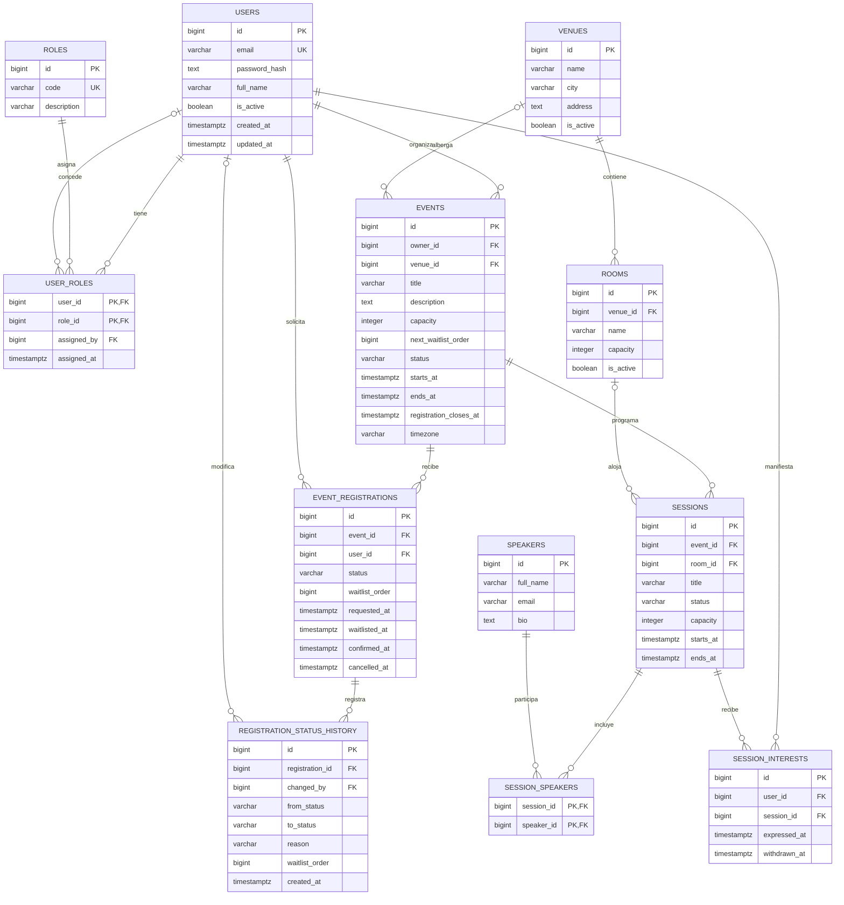

# 04 · Modelo de dominio y base de datos

**Producto:** Mis Eventos  
**Estado:** aprobado; implementado en la migración inicial `963f4d71a8f4`  
**Fecha:** 2026-10-27  
**Motor:** PostgreSQL  
**Implementación posterior:** SQLModel / SQLAlchemy + Alembic

## 1. Objetivo y trazabilidad

Diseñar un modelo relacional que represente el negocio sin mezclar tres conceptos diferentes: **inscripción confirmada al evento** (reserva cupo), **lista de espera del evento** (no reserva cupo) e **interés en una charla** (estadística, no reserva asiento). El modelo también debe garantizar propiedad y permisos, programación de salas y ponentes, y auditabilidad de inscripciones.

Este diseño parte de [01 · Problema, solución y alcance](01-problema-solucion-y-alcance.md) y [03 · Concurrencia, control de cupos y lista de espera](03-concurrencia-cupos-y-lista-de-espera.md). Separamos explícitamente **decisiones ya acordadas** de **precisiones propuestas** para que no se conviertan en requisitos implícitos.

### Decisiones ya acordadas

- Solo `ORGANIZER` y `ADMIN` crean eventos; un organizador únicamente puede modificar eventos propios, mientras que un administrador puede modificar cualquier evento y charla.
- La inscripción `CONFIRMED` garantiza una plaza en el **evento**; si se llena, el usuario entra a `WAITLISTED` y se promueve automáticamente cuando se libera o amplía el aforo.
- Las sesiones pueden ser simultáneas en salas distintas; no se permite solapar el uso de una sala ni de un ponente.
- Un asistente confirmado puede expresar interés por una o muchas charlas, incluso simultáneas. La manifestación de interés **no** consume cupo ni garantiza asiento.
- PostgreSQL es la fuente de verdad. Las operaciones de cupos se serializan mediante bloqueo transaccional de la fila `events`.

### Precisiones de modelado (aprobadas el 2026-10-28)

1. Usar claves primarias internas `BIGINT` generadas por identidad. No suponer que un ID difícil de adivinar sustituye autorización.
2. Guardar roles como `roles` + `user_roles` (un usuario puede tener más de un rol); nuevos usuarios reciben `ATTENDEE`.
3. Representar la lista de espera en `event_registrations` (**sin tabla adicional**), con `waitlist_order` monotónico **por evento**. Este es un refinamiento respecto al orden inicial `waitlisted_at, id`: evita depender del reloj para la prioridad FIFO. `waitlisted_at` permanece para visualización y auditoría.
4. Almacenar `events.next_waitlist_order` como secuenciador de **cola**, no como contador de asistentes. Se incrementa únicamente bajo el bloqueo del evento. Puede presentar huecos tras cancelaciones: eso es normal.
5. Mantener `events.confirmed_count` **fuera del MVP**. La ocupación se obtiene contando inscripciones confirmadas, protegidas por el bloqueo del evento. Solo se evaluará un contador transaccional si las mediciones muestran necesidad.
6. Permitir `sessions.status = DRAFT` sin sala asignada. Solo `SCHEDULED` reserva sala, requiere sala y participa en la validación de solapamientos.
7. Mantener una sola inscripción lógica por usuario y evento. Reactivar un registro `CANCELLED` inicia una nueva solicitud y pierde su prioridad antigua; el historial conserva los cambios anteriores.

## 2. Diagrama entidad-relación (ERD)

> El diagrama expresa el modelo **lógico**. Las reglas entre tablas (como aforo de sala o pertenencia de charla al mismo evento del interesado) no se deducen automáticamente de una FK y se detallan en §5.



**Convenciones:** `PK` = clave primaria; `FK` = clave foránea; `UK` = unicidad. Las FK dibujadas en `events.venue_id`, `sessions.room_id` y `registration_status_history.changed_by` son **opcionales**. Las relaciones `USER_ROLES` con asignador y `REGISTRATION_STATUS_HISTORY` con actor permiten `NULL` para creación inicial o acciones automáticas.

## 3. Diccionario de datos

Tipos convencionales: `BIGINT` (identidad), `VARCHAR(n)`, `TEXT`, `BOOLEAN`, `INTEGER`, `TIMESTAMPTZ`. Todas las tablas operativas llevan marcas `created_at` y/o `updated_at` cuando tiene sentido, aunque el ERD muestre solo los campos más importantes. Las fechas son instantes UTC mediante `TIMESTAMPTZ`; el huso de visualización se almacena aparte como nombre IANA (`America/Bogota`).

### 3.1 Identidad y permisos

#### `users`

| Columna | Tipo | Nulo | Condición / propósito |
|---|---|---|---|
| `id` | `BIGINT` | No | PK, identidad |
| `email` | `VARCHAR(320)` | No | Normalizado en aplicación, índice `UNIQUE` sobre `lower(email)` para unicidad sin importar mayúsculas |
| `password_hash` | `TEXT` | No | **Nunca** contraseña en claro; Argon2id en formato PHC (incluye sal y parámetros) |
| `full_name` | `VARCHAR(200)` | No | Nombre visible |
| `is_active` | `BOOLEAN` | No | `DEFAULT true` |
| `created_at`, `updated_at` | `TIMESTAMPTZ` | No | Fechas operativas |

#### `roles`

| Columna | Tipo | Nulo | Condición / propósito |
|---|---|---|---|
| `id` | `BIGINT` | No | PK |
| `code` | `VARCHAR(32)` | No | `UNIQUE`: `ATTENDEE`, `ORGANIZER`, `ADMIN`; catálogo inicial mediante migración/seed |
| `description` | `VARCHAR(200)` | Sí | Descripción funcional |

#### `user_roles`

| Columna | Tipo | Nulo | Condición / propósito |
|---|---|---|---|
| `user_id` | `BIGINT` | No | FK → `users.id`, parte de PK compuesta |
| `role_id` | `BIGINT` | No | FK → `roles.id`, parte de PK compuesta |
| `assigned_by` | `BIGINT` | Sí | FK → `users.id`, `NULL` si se asigna automáticamente al registrarse |
| `assigned_at` | `TIMESTAMPTZ` | No | `DEFAULT now()` |

**Seguridad:** el cliente no puede escribir directamente `user_roles` ni enviarse roles privilegiados en `POST /auth/register`. Los permisos efectivos se evalúan en el servicio mediante rol y propiedad `events.owner_id`; una FK no sustituye esa autorización.

### 3.2 Espacios y eventos

#### `venues`

| Columna | Tipo | Nulo | Condición / propósito |
|---|---|---|---|
| `id` | `BIGINT` | No | PK |
| `name` | `VARCHAR(160)` | No | Nombre de la sede |
| `address` | `TEXT` | Sí | Dirección |
| `city` | `VARCHAR(120)` | Sí | Ciudad |
| `is_active` | `BOOLEAN` | No | `DEFAULT true` |
| `created_at`, `updated_at` | `TIMESTAMPTZ` | No | Auditoría básica |

#### `rooms`

| Columna | Tipo | Nulo | Condición / propósito |
|---|---|---|---|
| `id` | `BIGINT` | No | PK |
| `venue_id` | `BIGINT` | No | FK → `venues.id` |
| `name` | `VARCHAR(160)` | No | `UNIQUE (venue_id, name)` |
| `capacity` | `INTEGER` | No | `CHECK (capacity > 0)` |
| `is_active` | `BOOLEAN` | No | `DEFAULT true` |
| `created_at`, `updated_at` | `TIMESTAMPTZ` | No | Auditoría básica |

**Regla cruzada (implementada):** solo atan una sala las charlas `SCHEDULED` que aún no terminan (`ends_at > now()`); las pasadas no cuentan. Mientras exista alguna, la sala no puede reducir su aforo por debajo de la charla más grande (409 `room_capacity_below_sessions`) ni desactivarse (409 `room_has_scheduled_sessions`), y su sede tampoco puede desactivarse (409 `venue_has_scheduled_sessions`): el sistema no reprograma ni cancela por su cuenta. Ambas operaciones bloquean primero la fila de la sala (o todas las salas de la sede, por ID ascendente) y luego consultan. Las sedes y salas no se borran: se desactivan.

#### `events`

| Columna | Tipo | Nulo | Condición / propósito |
|---|---|---|---|
| `id` | `BIGINT` | No | PK |
| `owner_id` | `BIGINT` | No | FK → `users.id`; autoriza ediciones del organizador |
| `venue_id` | `BIGINT` | Sí | FK → `venues.id`; puede estar pendiente mientras se planea |
| `title` | `VARCHAR(200)` | No | Nombre buscable |
| `description` | `TEXT` | Sí | Descripción |
| `capacity` | `INTEGER` | No | `CHECK (capacity > 0)`; plazas **del evento** |
| `next_waitlist_order` | `BIGINT` | No | `DEFAULT 1`, `CHECK (next_waitlist_order > 0)`; secuenciador FIFO bajo lock |
| `status` | `VARCHAR(16)` | No | `DRAFT`, `PUBLISHED`, `CANCELLED`, `COMPLETED` |
| `starts_at`, `ends_at` | `TIMESTAMPTZ` | No | `CHECK (starts_at < ends_at)` |
| `registration_closes_at` | `TIMESTAMPTZ` | Sí | Si no se define, se cierra al inicio del evento (política provisional) |
| `timezone` | `VARCHAR(64)` | No | Zona IANA, validada en aplicación |
| `created_at`, `updated_at` | `TIMESTAMPTZ` | No | Auditoría básica |

**Invariantes de servicio:** `COUNT(event_registrations WHERE status='CONFIRMED') <= events.capacity`; no permitir reducir `capacity` por debajo de confirmados; no admitir nuevos registros en eventos no publicados o fuera del periodo de inscripción; no borrar físicamente eventos con inscripciones.

### 3.3 Inscripciones y cola FIFO

#### `event_registrations`

| Columna | Tipo | Nulo | Condición / propósito |
|---|---|---|---|
| `id` | `BIGINT` | No | PK; identificador estable para futuras entradas/check-in |
| `event_id` | `BIGINT` | No | FK → `events.id` |
| `user_id` | `BIGINT` | No | FK → `users.id` |
| `status` | `VARCHAR(16)` | No | `CONFIRMED`, `WAITLISTED`, `CANCELLED` |
| `waitlist_order` | `BIGINT` | Sí | Orden asignado **bajo bloqueo** cuando entra/reentra a espera |
| `requested_at` | `TIMESTAMPTZ` | No | Momento de la solicitud más reciente; se renueva al reactivar |
| `waitlisted_at` | `TIMESTAMPTZ` | Sí | Fecha de la entrada más reciente a espera; informativa |
| `confirmed_at` | `TIMESTAMPTZ` | Sí | Última confirmación (si ocurrió) |
| `cancelled_at` | `TIMESTAMPTZ` | Sí | Última cancelación (si ocurrió) |
| `created_at`, `updated_at` | `TIMESTAMPTZ` | No | Auditoría básica |

**Unicidad:** `UNIQUE (event_id, user_id)`. **Integridad mínima:** cuando `status='WAITLISTED'`, `waitlist_order IS NOT NULL` y `waitlisted_at IS NOT NULL`. El índice único parcial sobre `(event_id, waitlist_order)` solamente para filas `WAITLISTED` protege de reutilizar la misma posición activa dentro del evento. Una inscripción cancelada se **reactiva** en vez de insertarse otra fila.

**Regla FIFO refinada:** cuando un usuario entra en espera, el servicio lee `events.next_waitlist_order` después de bloquear el evento, lo asigna al registro y lo incrementa dentro de la misma transacción. La promoción ordena por `waitlist_order ASC`, no por timestamps; si se cancela y vuelve a solicitar, obtiene un orden nuevo. `waitlisted_at` se conserva como dato informativo.

#### `registration_status_history`

| Columna | Tipo | Nulo | Condición / propósito |
|---|---|---|---|
| `id` | `BIGINT` | No | PK |
| `registration_id` | `BIGINT` | No | FK → `event_registrations.id` |
| `from_status` | `VARCHAR(16)` | Sí | `NULL` para la primera alta |
| `to_status` | `VARCHAR(16)` | No | Nuevo estado |
| `reason` | `VARCHAR(80)` | No | Ej.: `REGISTERED`, `EVENT_FULL`, `PROMOTED`, `USER_CANCELLED`, `EVENT_CANCELLED` |
| `waitlist_order` | `BIGINT` | Sí | Fotografía de la posición, cuando aplica |
| `changed_by` | `BIGINT` | Sí | FK → `users.id`; `NULL` para acción automática |
| `created_at` | `TIMESTAMPTZ` | No | Instante del cambio |

La historia es **append-only**: la aplicación no modifica ni elimina estados pasados. Registrar cambios en la misma transacción de la inscripción.

### 3.4 Charlas, ponentes e interés

#### `sessions`

| Columna | Tipo | Nulo | Condición / propósito |
|---|---|---|---|
| `id` | `BIGINT` | No | PK |
| `event_id` | `BIGINT` | No | FK → `events.id` |
| `room_id` | `BIGINT` | Sí | FK → `rooms.id`; obligatorio al programar (`SCHEDULED`) |
| `title` | `VARCHAR(200)` | No | Nombre de la charla |
| `description` | `TEXT` | Sí | Temática |
| `capacity` | `INTEGER` | No | `CHECK (capacity > 0)`, aforo de referencia; **no** cupos reservables |
| `status` | `VARCHAR(16)` | No | `DRAFT`, `SCHEDULED`, `CANCELLED` |
| `starts_at`, `ends_at` | `TIMESTAMPTZ` | No | `CHECK (starts_at < ends_at)` |
| `created_at`, `updated_at` | `TIMESTAMPTZ` | No | Auditoría básica |

Una sesión `SCHEDULED` exige `room_id NOT NULL`, pertenencia de la sala a la sede elegida para el evento, intervalo contenido en el evento, sala activa, capacidad `<= rooms.capacity` y ponentes sin solapamiento. Algunas de estas reglas cruzan tablas y se validan en transacciones. `DRAFT` no reserva sala; pasar a `SCHEDULED` debe verificar todas las condiciones de nuevo.

#### `speakers`

| Columna | Tipo | Nulo | Condición / propósito |
|---|---|---|---|
| `id` | `BIGINT` | No | PK |
| `full_name` | `VARCHAR(200)` | No | Ponente independiente de la cuenta de usuario |
| `email` | `VARCHAR(320)` | Sí | Contacto opcional; no equivale a `users.email` |
| `bio` | `TEXT` | Sí | Perfil |
| `created_at`, `updated_at` | `TIMESTAMPTZ` | No | Auditoría básica |

#### `session_speakers`

| Columna | Tipo | Nulo | Condición / propósito |
|---|---|---|---|
| `session_id` | `BIGINT` | No | FK → `sessions.id`; PK compuesta |
| `speaker_id` | `BIGINT` | No | FK → `speakers.id`; PK compuesta |

La FK única del ponente **no evita por sí sola** que participe simultáneamente en charlas distintas: al crear, reprogramar o reasignar sesiones, el servicio bloquea los ponentes involucrados y comprueba solapamientos de sesiones `SCHEDULED` dentro de una transacción.

#### `session_interests`

| Columna | Tipo | Nulo | Condición / propósito |
|---|---|---|---|
| `id` | `BIGINT` | No | PK |
| `user_id` | `BIGINT` | No | FK → `users.id` |
| `session_id` | `BIGINT` | No | FK → `sessions.id` |
| `expressed_at` | `TIMESTAMPTZ` | No | Última expresión de interés |
| `withdrawn_at` | `TIMESTAMPTZ` | Sí | `NULL` = interés activo; se puede retirar/reactivar |
| `created_at`, `updated_at` | `TIMESTAMPTZ` | No | Auditoría básica |

**Unicidad:** `UNIQUE (user_id, session_id)`. Para activar interés, verificar que el usuario tiene inscripción `CONFIRMED` **en el evento al que pertenece la charla**, no únicamente en cualquier evento. El interés puede exceder el aforo y puede corresponder a charlas simultáneas: se reporta como demanda estimada.

**Precisión pendiente:** al cancelar una inscripción confirmada proponemos retirar los intereses activos de ese usuario en ese evento en la misma transacción; la aplicación mantendrá el histórico `withdrawn_at`. Hay que confirmar este comportamiento antes de implementarlo.

## 4. Relaciones y cardinalidades clave

| Relación | Cardinalidad | Observación |
|---|---|---|
| `users` → `events` | 1:N | El propietario es creador/organizador; `ADMIN` puede editar sin cambiarlo |
| `users` ↔ `roles` | N:M | Tabla `user_roles` |
| `venues` → `rooms` | 1:N | Sala pertenece a una sede |
| `venues` → `events` | 1:N opcional en evento | Evento en planificación puede carecer de sede |
| `events` → `sessions` | 1:N | Varias charlas por evento |
| `rooms` → `sessions` | 1:N opcional en sesión | La misma sala admite charlas en horarios distintos |
| `users` ↔ `events` | N:M | Relación de negocio `event_registrations`, con estado |
| `event_registrations` → `registration_status_history` | 1:N | Cada transición deja evidencia |
| `sessions` ↔ `speakers` | N:M | Tabla `session_speakers` |
| `users` ↔ `sessions` | N:M | `session_interests`: solo interés informativo |

## 5. Restricciones: qué garantiza PostgreSQL y qué debe garantizar el servicio

### 5.1 Directamente en PostgreSQL

- **FK:** no pueden existir registros asociados a usuarios, eventos, sesiones o salas inexistentes.
- **UNIQUE:** `lower(users.email)`, `roles.code`, `(user_id, role_id)`, `(venue_id, room.name)`, `(event_id, user_id)`, `(session_id, speaker_id)`, `(user_id, session_id)`.
- **CHECK:** capacidades positivas, intervalos válidos, códigos de estado válidos, secuenciador positivo, y sala obligatoria en charla `SCHEDULED`.
- **UNIQUE parcial:** `(event_id, waitlist_order)` cuando `status='WAITLISTED'` para asegurar prioridades activas únicas.
- **EXCLUDE GiST:** dos sesiones `SCHEDULED` no pueden compartir sala cuando sus intervalos se solapan.
- **Índices:** búsqueda por título, contador de confirmaciones, extracción rápida de la cola FIFO.

### 5.2 En servicios transaccionales (reglas entre tablas)

- Comprobar **rol del actor y propiedad** del evento.
- Asegurar `confirmados <= event.capacity` antes del commit, bajo el lock de `events`.
- Atender lista de espera antes de dar un cupo liberado a un solicitante nuevo.
- No reducir el aforo del evento por debajo de confirmados.
- No asignar sesiones fuera del horario del evento, a salas de sede diferente o con `session.capacity > room.capacity`.
- No asignar un mismo ponente a sesiones activas con horarios solapados.
- No activar interés por charla sin inscripción confirmada al evento correcto.
- No reducir el aforo de una sala por debajo de la capacidad de una charla programada.
- Validar transiciones de estado y `timezone` IANA; la DB no puede expresar todas estas reglas con un `CHECK` simple.

> **Advertencia de arquitectura:** los servicios no están protegidos por magia. Todas las rutas que escriban datos relacionados deben aplicar estos contratos, incluso tareas administrativas, importaciones y procesos futuros. Las restricciones SQL ofrecen una defensa adicional para los casos que pueden expresarse a nivel de fila/índice.

## 6. SQL representativo de las restricciones importantes

Los siguientes fragmentos **no son el esquema completo ni migraciones ejecutadas**. Documentan las garantías que debemos implementar posteriormente con SQLAlchemy/Alembic. Su orden de aplicación dependerá de la creación de tablas.

### 6.1 Impedir dos sesiones programadas en la misma sala y horario

```sql
-- Se instalará desde la migración inicial (permiso del rol de migraciones).
CREATE EXTENSION IF NOT EXISTS btree_gist;

ALTER TABLE sessions
ADD CONSTRAINT ex_sessions_room_schedule
EXCLUDE USING gist (
    room_id WITH =,
    tstzrange(starts_at, ends_at, '[)') WITH &&
)
WHERE (status = 'SCHEDULED');
```

El intervalo `[)` incluye el inicio y excluye el final: una charla de 09:00 a 10:00 y otra de 10:00 a 11:00 **no** se superponen. Esto permite charlas simultáneas **en otras salas** y evita carreras entre dos organizadores que intenten programar la misma sala a la vez. La restricción GiST requiere que `room_id` tenga una clase de operador compatible, provista por `btree_gist`.

### 6.2 Una inscripción por usuario y evento, y cola indexada

```sql
ALTER TABLE event_registrations
ADD CONSTRAINT uq_event_registration UNIQUE (event_id, user_id);

ALTER TABLE event_registrations
ADD CONSTRAINT ck_waitlisted_has_order
CHECK (
    status <> 'WAITLISTED'
    OR (waitlist_order IS NOT NULL AND waitlisted_at IS NOT NULL)
);

CREATE UNIQUE INDEX uq_active_waitlist_order
    ON event_registrations (event_id, waitlist_order)
    WHERE status = 'WAITLISTED';

CREATE INDEX ix_confirmed_by_event
    ON event_registrations (event_id)
    WHERE status = 'CONFIRMED';

-- La cola puede recuperarse directamente en orden FIFO.
-- El índice UNIQUE anterior sirve también para esta consulta:
SELECT id, user_id
FROM event_registrations
WHERE event_id = :event_id AND status = 'WAITLISTED'
ORDER BY waitlist_order
LIMIT 10;
```

### 6.3 Búsqueda avanzada por parte del nombre

```sql
CREATE EXTENSION IF NOT EXISTS pg_trgm;

CREATE INDEX ix_events_title_trgm
    ON events USING gin (title gin_trgm_ops);

-- Búsqueda parcial sin distinguir mayúsculas:
SELECT id, title, starts_at
FROM events
WHERE title ILIKE :pattern; -- Ejemplo de parámetro: '%python%'
```

`pg_trgm` puede acelerar consultas `LIKE` y `ILIKE` que no tienen un prefijo fijo. El plan depende de la selectividad: búsquedas demasiado cortas pueden aprovechar poco el índice. La aplicación escapará caracteres comodín cuando el usuario busque texto literal.

### 6.4 Unicidad de correo sin distinguir mayúsculas

```sql
CREATE UNIQUE INDEX uq_users_email_ci
    ON users (lower(email));
```

Normalizar la entrada (espacios, minúsculas según política) y usar el índice de expresión evita cuentas duplicadas que solo difieren en mayúsculas. El mismo criterio debe usarse al iniciar sesión.

## 7. Flujos transaccionales y orden de bloqueos

### 7.1 Inscribirse / reactivar inscripción

1. Abrir transacción PostgreSQL `READ COMMITTED`.
2. Bloquear `events.id` (`SELECT ... FOR UPDATE`). **Solo después** volver a leer estado, aforo e inscripción existente.
3. Si ya está `CONFIRMED` o `WAITLISTED`, devolver su estado existente: no insertar ni volver al final de la cola por un reintento.
4. Si está `CANCELLED`, tratarlo como nueva solicitud manteniendo el mismo `registration.id`.
5. Si existen cupos libres y personas en espera, promover primero a la cola hasta agotar una de las dos condiciones.
6. Si queda cupo libre y no hay anteriores en espera, confirmar; en caso contrario, establecer `WAITLISTED`, asignar `waitlist_order = events.next_waitlist_order` e incrementarlo.
7. Insertar evento de `registration_status_history`, guardar cambios y hacer `COMMIT` antes de responder.

### 7.2 Cancelación y promociones

Bloquear el mismo evento, cambiar la inscripción a `CANCELLED`, contar cupos y promover en orden ascendente de `waitlist_order` hasta completar el aforo o vaciar la cola, dejando historial en la misma transacción. Un `ROLLBACK` restaura tanto la cancelación como cualquier promoción parcial.

### 7.3 Aumento/reducción de capacidad

Bloquear la fila del evento antes de editar `capacity`. En aumentos, atender lista FIFO antes de permitir nuevas inscripciones; en reducciones, rechazar si la nueva capacidad es menor que el número confirmado. Las transacciones concurrentes sobre otros eventos pueden progresar independientemente.

### 7.4 Crear o mover charlas

Adoptar un orden global de bloqueos para rutas de programación: **evento afectado → salas afectadas (ID ascendente) → ponentes afectados (ID ascendente) → sesión/asignaciones**. Comprobar permisos, evento, disponibilidad, aforos y horarios después de bloquear, incluido que la sala y su sede sigan activas (desactivarlas bloquea esas mismas filas de `rooms`, así que ambas operaciones quedan serializadas); guardar dentro de la misma transacción. El índice de exclusión GiST es la defensa final para la disponibilidad de la **sala**; la disponibilidad de **ponentes** necesita bloqueo y consulta al no disponer de su intervalo en la tabla intermedia.

> El orden global debe cumplirse al editar fechas, cancelar/programar sesiones, cambiar ponentes y cambiar salas. Si una operación toca varias entidades existentes, bloquear identificadores antiguos y nuevos en orden estable. No mantener locks durante llamadas HTTP externas. Implementar timeout de adquisición y manejo acotado de errores transitorios.

### 7.5 Ejemplo crítico de carrera

```text
Evento: capacidad 5.000; confirmados 4.999
Solicitudes nuevas: 1.000 usuarios diferentes

Transacción A obtiene lock del evento:
    confirma 1 inscripción; COMMIT

Transacciones restantes adquieren el mismo lock de forma sucesiva:
    encuentran aforo completo
    crean/reactivan WAITLISTED con orden 1..999; COMMIT

Resultado (si todas concluyen correctamente):
    CONFIRMED total = 5.000
    WAITLISTED nuevos = 999
    sobrecupos = 0
```

El orden depende de cuándo se **procesa/serializa** cada solicitud bajo el lock, no de la hora en que el usuario presionó el botón. El número de peticiones HTTP no equivale al número de conexiones abiertas a PostgreSQL.

### 7.6 Cancelar evento

Una sola transacción, con el mismo orden global de bloqueos (evento primero):

1. Bloquear la fila del evento (`SELECT ... FOR UPDATE`) y, después, verificar permisos (propietario o `ADMIN`) y estado. Solo se cancelan eventos `DRAFT` o `PUBLISHED`; si ya está `CANCELLED`, devolver su estado sin cambios (idempotente ante reintentos, como §7.1).
2. `events.status = 'CANCELLED'`.
3. Inscripciones `CONFIRMED` y `WAITLISTED` → `CANCELLED` con `cancelled_at`, en **una sola sentencia** sobre el conjunto (no fila a fila desde la aplicación). En la misma transacción, insertar su historial con `reason = 'EVENT_CANCELLED'`, `from_status`, la foto de `waitlist_order` y `changed_by` = actor. **No hay promociones.**
4. Charlas no canceladas → `CANCELLED`; las `SCHEDULED` liberan su sala.
5. Intereses activos en sus charlas → `withdrawn_at = now()`, misma regla que al cancelar una inscripción (§12).
6. `COMMIT` antes de responder.

Así el estado de cada inscripción es verdadero por sí solo: las consultas de «mis inscripciones», el conteo de confirmados y la regla de interés (§3.4) no necesitan consultar `events.status`. El costo es bajo: dos sentencias indexadas por `event_id`; cada fila genera una versión nueva (MVCC) que limpiará autovacuum.

## 8. Política de integridad y borrado

- **Usuarios:** preferir `is_active=false`; conservar referencias históricas. El borrado de datos personales deberá diseñarse conforme a requisitos legales específicos.
- **Eventos:** con inscripciones, preferir estado `CANCELLED` en vez de `DELETE` físico.
- **Salas y sedes:** preferir `is_active=false` cuando ya existan referencias; `ON DELETE RESTRICT` para dependencias importantes.
- **Ponentes:** solo se borran si nunca figuraron en una charla (de cualquier estado); lo decide la FK `ON DELETE RESTRICT` de `session_speakers`, sin consulta previa, así que una asignación concurrente no puede colarse. Desactivar o archivarlos es una posible evolución.
- **Inscripciones:** conservar fila y auditoría; no eliminar por cancelación.
- **Intereses:** actualizar `withdrawn_at`, no eliminar para mantener trazabilidad mínima.
- **Auditoría:** los cambios de estado deben registrarse en la misma transacción; si en el futuro se requiere auditoría resistente a cualquier escritura directa en BD, valorar un trigger o permisos específicos.

## 9. Índices, consultas y métricas mínimas

| Consulta / necesidad | Índice o estrategia | Observación |
|---|---|---|
| Login por correo | `UNIQUE INDEX lower(users.email)` | Evita duplicados sin distinguir mayúsculas |
| Eventos por título parcial | `GIN (title gin_trgm_ops)` | Requiere `pg_trgm` |
| Eventos publicados por fecha | `INDEX (status, starts_at, id)` | Ayuda con filtro, orden y paginación |
| Eventos por organizador | `INDEX (owner_id, starts_at)` | Para panel del propietario |
| Confirmados por evento | Índice parcial `event_id WHERE status='CONFIRMED'` | `COUNT(*)` dentro de transacción |
| Cola FIFO | `UNIQUE INDEX (event_id, waitlist_order) WHERE status='WAITLISTED'` | Sirve para promover por antigüedad |
| Inscripciones del usuario | `INDEX (user_id, status, event_id)` | Panel «mis inscripciones» |
| Sesiones de un evento | `INDEX (event_id, starts_at)` | Agenda |
| Charlas de un ponente | PK compuesta `(session_id, speaker_id)` + `INDEX(speaker_id, session_id)` | Validación de conflictos |
| Interés activo por charla | Índice parcial `session_id WHERE withdrawn_at IS NULL` | Estimación de demanda |
| Historial de una inscripción | `INDEX (registration_id, created_at, id)` | Auditoría |

No crear índices duplicados a los que ya generan `PRIMARY KEY` y `UNIQUE`. Medir planes con `EXPLAIN (ANALYZE, BUFFERS)` cuando exista volumen representativo.

**Métricas derivadas, no columnas redundantes:** confirmados, libres (`max(capacity - confirmados, 0)`), tamaño de lista, porcentaje de ocupación, interesados por charla y demanda frente al aforo. Su consulta no debe tomar un bloqueo de escritura para mostrar datos orientativos; la decisión final de inscripción sí requiere la transacción protegida.

## 10. Reglas de compatibilidad con SQLModel y Alembic

- Declarar tablas y relaciones con SQLModel; usar objetos `sqlalchemy.Column`, `Index`, `CheckConstraint`, `UniqueConstraint`, `ForeignKeyConstraint` o migraciones SQL para funciones avanzadas de PostgreSQL.
- Las restricciones **GiST de exclusión**, índices parciales y extensiones `btree_gist`/`pg_trgm` deben revisarse manualmente en Alembic: no asumir que `--autogenerate` puede inferirlas o recrearlas por completo.
- Elegir nomenclatura estable: `pk_`, `fk_`, `uq_`, `ck_`, `ix_`, `ex_`.
- Evitar `create_all()` como mecanismo de producción: el esquema se crea y evoluciona mediante Alembic.
- Crear semillas iniciales de roles mediante migración idempotente o comando reproducible; documentar cómo se crea **el primer administrador** sin habilitar autoescalada de privilegios. Implementado: `just create-admin <email> "<nombre>"` (lee la contraseña de `ADMIN_PASSWORD` o la pide dos veces; nunca como argumento) crea el usuario con `ATTENDEE` + `ADMIN` en una transacción. Requiere acceso a la shell del servidor, no a la API.
- Mantener pruebas de migración «base vacía → head» y de restricciones con PostgreSQL real.

## 11. Pruebas que deben acompañar las migraciones

| ID | Escenario | Resultado exigido |
|---|---|---|
| DB-01 | Dos usuarios con el mismo correo en distintas mayúsculas | Rechazo por unicidad |
| DB-02 | Un usuario se registra dos veces al mismo evento | Una sola fila lógica |
| DB-03 | 1.000 solicitudes compiten por un cupo | Una confirmación adicional y las demás en espera si completan |
| DB-04 | Cancelación y promoción concurrente | Sin sobrecupo y FIFO por `waitlist_order` |
| DB-05 | Usuario cancela y se reinscribe | Conserva `registration.id`, recibe posición nueva en espera si corresponde |
| DB-06 | Dos charlas solapan la misma sala | PostgreSQL rechaza mediante exclusión |
| DB-07 | Charlas simultáneas en salas distintas | Permitidas si los ponentes no se repiten |
| DB-08 | Un ponente aparece simultáneamente en charlas diferentes | Servicio rechaza, incluso en concurrencia |
| DB-09 | Interés en charla de evento ajeno/no confirmado | Rechazo |
| DB-10 | Intereses exceden la capacidad de la sala | Permitidos, se reporta sobredemanda |
| DB-11 | Organizador modifica evento ajeno | `403 Forbidden`; administrador sí puede |
| DB-12 | Reducción concurrente de aforo | No se permite quedar por debajo de confirmados |
| DB-13 | Sala con capacidad menor que charla existente | Cambio de aforo rechazado |
| DB-14 | Transacción falla antes de commit | No quedan cambios parciales ni historial incorrecto |

## 12. Riesgos y decisiones por cerrar

| Punto | Estado | Propuesta / impacto |
|---|---|---|
| Orden FIFO | **Acordada** | `waitlist_order` monotónico por evento bajo lock |
| Estados de charla | **Acordada** | `DRAFT`, `SCHEDULED`, `CANCELLED`; solo `SCHEDULED` reserva sala |
| Alta de charla sin sede | **Acordada** | Permitir borrador; programar requiere sala válida en sede del evento |
| Cancelación de interés | **Acordada** | Al cancelar la inscripción o el evento, los intereses activos se retiran (`withdrawn_at`) en la misma transacción |
| Estados del evento | **Acordada** | `DRAFT`→`PUBLISHED` (sede activa y sin haber empezado), `PUBLISHED`→`COMPLETED` (manual, después de `ends_at`), `DRAFT`/`PUBLISHED`→`CANCELLED`. No se vuelve a `DRAFT`; `CANCELLED` y `COMPLETED` son finales. Repetir la transición al estado actual devuelve el evento sin cambios |
| Edición de eventos | **Acordada** | Solo `DRAFT`/`PUBLISHED`. Aforo: no baja de confirmados y al subir promociona la espera (§7.3). Fechas: las charlas no canceladas deben quedar dentro. Sede: activa, no cambia con charlas `SCHEDULED` y un evento publicado no puede quedarse sin ella. `registration_closes_at` ≤ `ends_at` |
| Evento cancelado | **Acordada** | Inscripciones activas → `CANCELLED` con motivo `EVENT_CANCELLED` en el historial; charlas → `CANCELLED`; flujo en §7.6 |
| Inscripción fuera de fecha | **Pendiente** | Cierre en `registration_closes_at` o, si falta, al comenzar evento |
| Correos de promoción | **Fuera del MVP** | Estado consultable vía API; futuro outbox/notificaciones |
| Hash de contraseñas | **Acordada** | Argon2id con `pwdlib`; ver docs/01 «Seguridad de contraseñas» |
| Aforo del evento vs. ponentes/equipo | **Pendiente** | Por ahora la capacidad cuenta exclusivamente inscripciones confirmadas |
| Campos geográficos | **Pendiente** | Dirección/ciudad básicas en MVP; geolocalización y eventos híbridos después |

### Definición de terminado de esta fase

El documento estará **aprobado** cuando se cierren las precisiones que afectan migraciones (secuencia FIFO, estados de charla, cancelación de evento/intereses), se revise el ERD, y se validen reglas, claves e índices. **Solo entonces** generaremos las migraciones iniciales con Alembic y sus pruebas.

## 13. Referencias técnicas

- [PostgreSQL · CREATE TABLE (constraints)](https://www.postgresql.org/docs/current/sql-createtable.html)
- [PostgreSQL · Range Types](https://www.postgresql.org/docs/current/rangetypes.html)
- [PostgreSQL · CREATE INDEX, índices parciales](https://www.postgresql.org/docs/current/sql-createindex.html)
- [PostgreSQL · `pg_trgm`](https://www.postgresql.org/docs/current/pgtrgm.html)
- [PostgreSQL · Explicit Locking](https://www.postgresql.org/docs/current/explicit-locking.html)
- [PostgreSQL · Transaction Isolation](https://www.postgresql.org/docs/current/transaction-iso.html)
